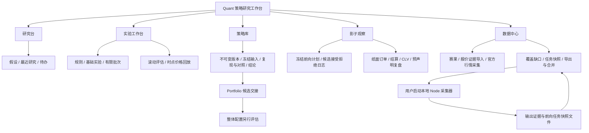

# Quant 策略研究工作台

Quant 把直觉组织为可定义、可复现、可追踪的策略研究。工作流依次覆盖研究闭环、前向证据、受控批次与验证。实现代码、数据覆盖、任务运行和验收状态需要分别说明。

**当前交付边界：用户已授权开发完成后执行测试。验证结果由交付记录单独汇总，本文不预填通过数量或验收结论；未启动任何常驻采集进程。代码提供真实报价回放路径，不表示本机已有完整历史报价，也不表示已通过研究有效性验证。**

## 功能与产品架构



- **研究台**：最近研究、实验与待处理事项；原有发现扫描作为探索入口，输出候选假设。
- **实验工作台**：研究假设、失效条件、研究笔记、日期协议及基础规则；扩展有限参数批次、滚动评估与时点回放。
- **策略库**：项目、版本、实验快照、结论、复现、对照和 JSON 导出。
- **影子观察**：冻结的前向计划、完整的已检查候选日志、不可变纸面订单及预先声明的复盘标准。旧策略台账与新前向研究分别保留。
- **数据中心**：赛果、逐时点报价、来源、可知时间、覆盖情况、官方行情采集和独立任务快照。

顶部“使用指南与设计思路”使用 `components/quant/QuantGuideDialog.jsx` 与独立 `quantGuide.css`。`QuantGuideDialog({ open, onClose })` 自行 portal 到 body，通过原生 dialog 实现焦点约束与背景 inert；11 章内容包含目录跳转、JSON 示例、架构图和操作流程。支持 Escape、遮罩关闭、焦点返回、内容滚动与小屏目录。实现尚待键盘和浏览器验收。

## 按三阶段使用

### 阶段一：定义并保存研究

1. 写下研究假设与可能推翻它的结果，确定球队、主客场、比分或胜平负、概率来源、计划场次与资金参数。
2. 检查数据条件：只有赛果时做频率研究；填写人为赔率时做情景分析；输入概率和价格假设时做条件推演。
3. 运行后保存策略版本、输入快照和结果，记录结论与下一步。
4. 修改规则后生成新版本。复现使用已冻结输入，最新数据重跑另建实验。
5. 对照前检查实验类型、数据指纹、时间协议、资金和赔率假设，不把不同条件下的收益差直接称为改进。

基础研究入口为 `src/lib/quantResearch.js`。实验类型 `frequency` 不输出收益；`scenario` 使用统一假定赔率；`simulation` 冻结行情、评级与资金上下文，结论受所输入条件约束。

### 阶段二：冻结前向计划

1. 从已有研究版本冻结一份计划。每个版本只允许一份计划，固定注码继承原版本；改变规则或复盘标准需创建新版本。
2. 预先声明 `reviewAt`、`minSettled`、`maxDrawdown`、`minExpectedRoi`，以及入场和收盘报价的新鲜度窗口。复盘时间必须是未来且带时区的 ISO 时间。
3. 用真实当前决策时间处理已经观察到的赛事：记录范围不符、已开赛、缺价、过期、停盘、模型缺失、重复、风险限制、预期收益门槛等拒绝原因。
4. 符合规则的候选创建不可变纸面订单。每个版本与赛事组合最多一张订单，绑定规则、报价和概率快照；再次检查不能重复建单。
5. 使用同一 canonical eventId 的赛果结算，要求 `availableAt <= now`。未结算订单遇到冲突时继续保留；已经结算后补入冲突结果时，追加争议记录并保留原结算历史，将该订单从当前指标中排除，暂停该计划新增订单。
6. 到预声明时间后，仍需达到最低已结算样本。统计和状态变化不自动代表策略有效，也不会自动转为实际投资。

前向入口为 `src/lib/quantForward.js`：`createObservationPlan` 冻结计划，`processForwardBatch` 是页面与采集器共享的纯处理函数，`runForwardTask` 负责浏览器存储，`forwardPlanMetrics` 派生统计，快照经 `mergeForwardStores` / `importForwardSnapshot` 合并。

CLV 采用 `entryOdds / closingOdds - 1`。收盘报价必须与入场的市场、选择、来源匹配，且位于开赛前声明的新鲜度窗口；缺失为 `null`，不填成 0。ROI 仅统计已结算纸面订单。Brier 仅使用已冻结预测概率的已结算覆盖子集。前后表现变化至少需要两段各 10 单，仍只描述变化。

状态包括 `observing`、`insufficient_sample`、`data_disputed`、`risk_limit_reached` 和 `review_ready`；最后一种表示等待人工复盘，不代表通过认证。争议订单不计入当前 ROI、Brier、CLV 和回撤，但保留原始记录。“完整候选日志”指进入证据范围且实际检查过的候选；未采集到的赛事、进程停止期间错过的报价不会自动成为完整历史记录。旧台账的启发式转正条件不构成独立认证。

### 阶段三：受控扩展与候选交接

**有限参数批次**先冻结候选全集，最多 30 个组合；围绕当前规则的主客场、胜平负选项（适用时）和假定赔率展开。冻结本身不自动运行所有组合，保留全部候选。

**滚动评估**提前声明 `trainDays`、`testDays` 和最低训练样本。每个 fold 只用训练窗命中率排序，平手按冻结候选顺序选择；人为赔率不参与规则选优。后窗之间不重叠，保留每个候选的训练统计、选中规则及各窗的接纳和排除明细。后窗收益使用统一假定赔率，属于情景结果。

**真实报价回放**从带时区的开赛时间派生决策时点（开赛前指定分钟数），只选取该时点可得、开赛前、可交易且未过期的报价。缺失或冲突证据保留排除理由；赛果按 `availableAt` 结算，同一结算时间成组计入盈亏与回撤。主队视角参考基准只使用同事件、相应市场且双方报价都合格的交集，不能将覆盖差异解释为因果贡献。

**探索记录**保留数据指纹、累计执行历史与批次信息。只能追踪本模块的行为，不能证明用户未在外部或其他页面查看过数据，因此不自动将后窗标记为未经查看的独立验证。

**Portfolio 交接**创建带有研究来源和规则的候选。先在收件箱核对并加入候选池，组合使用冻结预测概率，不重复套用另一轮校准。仅发送或加入候选池不会创建投资；用户在 Portfolio 明确采纳方案后才写入 investment，保存前重新检查候选状态、开赛时间与报价时效，逐条保留相应研究来源。不连接外部下单。

验证研究入口为 `src/lib/quantValidation.js`，与基础研究分开保存，引用不可变研究版本。

## 数据与存储契约

```text
ResearchProject
  └─ StrategyVersion（规则、研究说明、协议）
       ├─ ExperimentRun（冻结输入、结果、数据指纹、引擎、随机种子、结论）
       ├─ ForwardPlan（复盘时间、样本门槛、风险与报价条件）
       │    ├─ CandidateLog（接受 / 拒绝 / 原因 / 检查时间）
       │    └─ PaperOrder（真实赛前报价、概率快照、结算、CLV）
       │         └─ Dispute（后补冲突事实，保留历史并排除当前指标）
       ├─ ParameterBatch（完整候选集合）
       ├─ ValidationRun（训练与后窗、探索历史、回放明细）
       └─ PortfolioCandidate（研究来源与交接理由）

EvidenceStore
  ├─ events（已观察赛事）
  ├─ quotes（市场、选择、赔率、采集时间、来源、可交易状态）
  ├─ results（准确赛事身份、赛果、可知时间、来源）
  └─ imports（新增记录数量、导入时间、来源标签、任务快照）
```

- 浏览器存储统一经过 `brandStorage`；公开预览使用隔离的 `previewStore` 内存。
- 基础研究键为 `eivra.quant_research.v1`，证据键为 `eivra.quant_evidence.v1`。研究、证据、前向和验证档案保持分离，当前不加入云同步。
- 基础研究每次新运行创建版本；复现沿用原版本并追加运行。保存时冻结输入，脱离调用方引用。
- 每个浏览器研究 store 按约 4 MiB 的保守上限处理，采用 UTF-16 估算；浏览器对整个站点的共享存储额度可能更早耗尽。损坏或容量不足时报错，不静默裁剪历史。脚本输出容量与浏览器可导入容量是不同限制。
- 记录与证据的内容标识用于去重和冲突检查，不是来源真实性签名。导入者仍需确保记录真实、时间正确、来源可核查。
- 官方行情采集与外部 JSON 均不能事后创造未留存的历史报价。今天首次看到的赛果使用真实首次可知时间，不补写虚构的过去时间。

## 证据 JSON 格式

入口为 `src/lib/quantEvidence.js`。外部时间必须是带 `Z` 或 `±HH:MM` 的 ISO 字符串，禁止猜测本地时区。只有官方站点适配器把该站的无时区时间按 `Asia/Shanghai`（+08:00）解释。

下面是**格式示意，非真实比赛或研究数据**。导入前应替换为真实记录，不应拿示意数据评估策略。

```json
{
  "schemaVersion": 1,
  "events": [
    {
      "home": "示例主队",
      "away": "示例客队",
      "kickoff": "2026-10-18T20:00:00+08:00",
      "observedAt": "2026-10-18T19:30:00+08:00",
      "source": "你的真实数据来源",
      "tradable": true
    }
  ],
  "quotes": [
    {
      "home": "示例主队",
      "away": "示例客队",
      "kickoff": "2026-10-18T20:00:00+08:00",
      "market": "result",
      "selection": "draw",
      "odds": 3.4,
      "observedAt": "2026-10-18T19:30:00+08:00",
      "sourceUpdatedAt": "2026-10-18T19:29:00+08:00",
      "source": "你的真实数据来源",
      "tradable": true
    }
  ],
  "results": [
    {
      "home": "示例主队",
      "away": "示例客队",
      "kickoff": "2026-10-18T20:00:00+08:00",
      "homeGoals": 1,
      "awayGoals": 1,
      "availableAt": "2026-10-18T22:10:00+08:00",
      "source": "你的真实数据来源"
    }
  ]
}
```

- `events`、`quotes`、`results` 为可选数组，`schemaVersion` 必须为 1。事件记录可以保留有赛事却缺目标市场报价的事实。
- `home` / `away` 与带时区的 `kickoff` 共同构成 canonical eventId；`id` 与 `eventId` 由引擎生成，不能依赖外部自定义标识强行连接不同赛事。
- `market: result` 对应 `home` / `draw` / `away`。`market: score` 使用主队在前的 `0-0`、`1-1`、`2-1` 等比分字符串。
- `odds` 为大于 1 的十进制赔率。`tradable: false` 保留停盘证据，价格存在不代表可交易。
- `observedAt` 不能晚于当前时间；可选 `sourceUpdatedAt` 不能晚于 `observedAt`。赛果 `availableAt` 必须不早于开赛且不晚于当前时间。
- 单条平局报价不够生成完整市场概率。市场概率路径需要同来源、同采集时点的完整胜平负报价；缺失时返回不可用。
- 评级模型只使用决策时已经可知、没有赛果冲突的历史结果。自定义概率属于明确声明的研究假设，不能伪装成历史实测预测。
- 同一来源、同一采集时间、同市场和选项的冲突价格会导致排除；同一赛事的冲突赛果不会擅自择一结算。
- 数据中心的“同时有报价和赛果”数量只是潜在覆盖提示。真正可回放数量还取决于决策时点、市场、交易状态、报价年龄和冲突检查。

## 独立采集器：配置、运行、导回

采集器位于 `scripts/quant-collector.mjs`。需要 Node.js 18 或更新版本，并已安装项目的 npm 依赖（包含 Vite）。它使用 Vite SSR 加载共享引擎，无须启动网页 HTTP 服务或执行生产构建；它是用户自行启动的本地进程，没有自动部署的远程服务，也没有与浏览器保持实时同步。

1. 在浏览器中冻结所需前向计划，并在数据中心导出采集配置。配置携带冻结的前向档案与已有证据。
2. 在 `eivra-studio/` 项目目录运行下列命令（这里只提供命令，本轮未执行）：

   ```sh
   npm run quant:collect -- --config ./quant-collector-config.json --output ./quant-collector-snapshot.json --interval 300
   ```

3. 保持电脑及进程运行。进程定时读取官方行情/赛果，调用与页面共享的纯前向处理逻辑，将证据、日志、纸面订单和任务状态写入输出快照。
4. 从数据中心导入快照文件，合并证据及不可变订单/日志。浏览器不能自动读取该文件；页面展示的是最近导入时的任务状态，不是采集进程的实时心跳。
5. 修改冻结计划集合后重新导出配置；停止进程或关闭电脑后不再采集。采集器无法补造停止期间错过的赛前报价。

当前采集器查询最近 7 天的官方赛果，仅请求首批最多 100 条，没有自动翻页。官方赛果若缺少精确开赛时间，只在已知事件中找到唯一对应项时接入，并使用首次实际看到结果的时间。无法唯一匹配、超出接口首批或尚未获取的结果保留缺口。

采集器输出 JSON 按 UTF-8 字节计算设有 50 MiB 上限；达到上限时停止并保留上一次完整文件，不裁剪历史。该上限不代表浏览器能够导入 50 MiB：页面文件入口与各 store 容量另外受限。应定期导入、检查浏览器剩余容量并保存外部归档，不应等文件达到脚本上限后再首次导回。现阶段没有自动分档或无限历史存储机制。

导入的普通证据文件、采集器快照和研究档案导出用途不同；研究导出用于留存，不承诺当前存在任意完整档案恢复界面。重要资料应保留副本，清理站点数据、更换浏览器或设备前先核对备份。

## 指标和研究解释边界

- 历史频率是描述性研究；统一假定赔率情景不是可执行历史收益。
- 基础实验的后段切分不等于独立验证；滚动评估隔离每轮选规则的数据，但无法消除过去对同一数据的查看。
- 多个同场头寸不等于多个独立样本；比分和胜平负可能重叠，缺少联合分布时组合风险仍应不可用。
- CLV 有效性依赖同源、同市场和时点可比性，正向 CLV 不独立证明长期收益。
- 没有普遍有效的“满 20 场或 30 场即通过”。前向最低样本是预声明的研究条件，不是统一统计认证线。
- 当前没有任意条件编排、独立联赛筛选、模型注册、配对因果贡献归因或多设备研究云同步的交付承诺。
- 真实回放仍只支持已实现的市场和规则。引擎可用、证据覆盖足够、结果可靠与原生环境验收是不同状态。

## 已授权的验证范围

以下是应执行并由交付报告汇总的验证范围，不代表此列表已经通过：

1. 基础冻结与复现、数据冲突与重复、比较边界、存储失败和预览隔离。
2. 前向计划冻结、赛前时点、接受/拒绝日志、重复采集幂等、纸单结算、复盘与 CLV 条件。
3. 批次上限、训练窗选优、后窗不重叠、重复探索留痕、真实报价回放及同一结算时间的稳定性。
4. 导入时区/来源/身份/冲突检查、停盘和过期价、市场概率完整性、评级时间隔离。
5. 采集器配置、故障恢复、输出快照合并和页面状态；不得将命令示例视为已经启动任务。
6. 完整浏览器流程、键盘和焦点操作、指南长内容滚动、桌面与小屏布局。
7. 全项目 lint、测试、生产构建及仓库要求的最终交付流程。

完成验证后，分别报告实现结果、实测结果、真实数据覆盖和任务运行状态。
